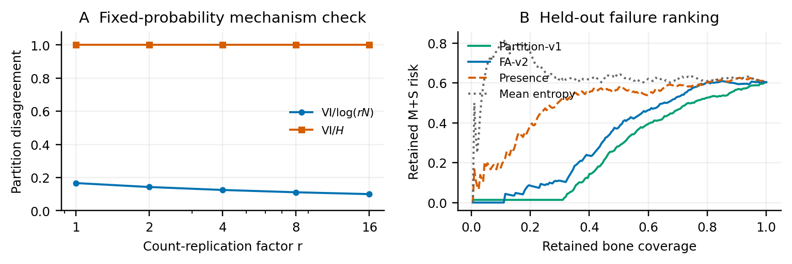

# Presence or Partition? Endpoint-Dependent Failure Detection in 3D Fracture Segmentation

Anonymous scientific draft for author review.

## Abstract

Disagreement among instance segmenters can reflect missing foreground or different partitions of shared foreground. These mechanisms need not identify the same errors. We examine their separation in three-model segmentation of peripelvic fractures on CT. On 40 development scans, we quantify component contributions and test controlled merge, split, omission, boundary, and count-replication perturbations. A separate 100-scan evaluation compares 12 fixed scores using case-clustered bootstrap intervals. Joint-entropy normalization improves the combined score over foreground disagreement and mean entropy for pooled merge/split ranking: area under the risk--coverage curve decreases from 0.4942 and 0.6358 to 0.3311. However, the original partition-only component performs better (0.2720). Supplementary one-to-one and significant-overlap endpoints remove clear evidence of that component's advantage over the combined score. Count-based fusion also lacks a clear development gain. Shared omissions can yield zero disagreement, and fixed-budget review benefits remain uncertain. The findings support component-aware, endpoint-specific evaluation of instance disagreement rather than a universal ranking advantage or demonstrated clinical review savings.


**Keywords:** 
instance segmentation, uncertainty, fracture CT, quality control, failure detection


## Introduction

Fragment-level CT segmentation can support geometric analysis of peripelvic fractures, but a plausible foreground mask can conceal incorrect fragment grouping. A merged or split fragment changes the instance representation even when foreground overlap is high. Before using such segmentations downstream, a quality-control system should identify the failures relevant to that representation. The public PENGWIN dataset provides annotated peripelvic fracture instances for studying this problem [pengwin2026].

Deep ensembles offer prediction-based uncertainty estimates [lakshminarayanan2017]. For instance maps, however, foreground disagreement and disagreement about object membership are different quantities. Averaging an information-based partition term with a foreground term can suppress one component or prioritize a different error mechanism. Changing normalization increases the numerical contribution of a component, but does not by itself establish better failure ranking. Furthermore, a useful ranking over all coverage levels need not improve review at a small, fixed budget.

Related biomedical work already connects uncertainty to annotation inspection and image quality control. AI$^2$Seg combines prediction confidence with annotation mismatch for instance-annotation inspection [schilling2023]; this setting has access to the annotations being inspected. Artifact augmentation addresses whole-slide-image quality control [jurgas2023], whereas an instance-segmentation dataset study illustrates the importance of reporting detection and segmentation outcomes separately [reich2023]. These applications motivate explicit quality targets, but do not establish a ground-truth-free structural-failure detector for fracture CT. Reference-based quality estimation can introduce additional information beyond agreement [valindria2017]. Metric-selection frameworks likewise warn that the evaluation unit, matching rule, and target structure affect the meaning of reported performance [reinke2024, maier2024].

This study makes three contributions: it separates and tests the mechanisms of foreground and partition disagreement; compares both components and their combination against strong controls on a case-disjoint evaluation set; and examines how matching conventions, omission, and review cost change the conclusions. It reports successful contrasts together with stronger baselines and unsuccessful fusion attempts. The aim is to characterize when disagreement is informative, without assuming that its combined form must be superior.


## Methods


### Data, Models, and Evaluation Units

We used the public labeled PENGWIN 2026 Task 1 CT dataset [pengwin2026]. The evaluation involved 40 development scans and 100 additional scans, each balanced between pelvic and femur scan types. The latter were selected with a fixed seed from 210 eligible cases after excluding the initial training cases, development cases, and a separate local hold-back split. The local hold-back was not the official challenge test set and was not evaluated here. Case IDs, split hashes, and model manifests were checked. This establishes case separation; it does not independently establish patient-level separation across the source collection.

Three ensemble members used the same public ABBC/STU-Net backend and initial 40-case training selection, with different model seeds (31001--31003). The implementation used nnU-Net 2.5.1 infrastructure [isensee2021] and a pinned, patched backend [abbc]. An anatomy stage localized the bone crops, followed by fragment segmentation and affinity-based reconstruction. A separate Stage 2 model provided a risk-source sensitivity analysis; it belongs to the same backend family and is not cross-architecture validation. Each model used its fixed anatomy and fragment checkpoint choices. No model was trained on the additional 100 evaluation cases.

Scoring followed the declared annotation scope: three bones per pelvic scan (sacrum, left hip, right hip), and one femur unit per femur scan. This produced 80 development and 200 held-out bone units. Pooled bone-level statistics consequently weight a pelvic CT three times as much as a femur CT. Within the annotation scope, predicted components smaller than 1,000 mm$^3$ were removed using 26-connectivity; reference instances were retained. Bone identity came from scan metadata and predicted anatomy IDs, not a ground-truth region of interest (ROI).

For the ensemble, foreground probabilities were linearly mapped to the native grid and combined across anatomy crops by a voxelwise maximum. Entropy used these saved foreground maps, not separate bone-specific probability channels. Its ROI for each bone was the union of cleaned member foregrounds. Ground truth entered only subsequent evaluation or controlled perturbation generation. Held-out inference comprised 300 ensemble-member runs and 100 Stage 2 runs.


### Separating Presence and Partition

For one member pair, let $F_i,F_j$ denote foreground sets, $U=F_i\cup F_j$ their union, and $C=F_i\cap F_j$ their intersection. Presence disagreement and overlap weight are

$$

 A=\frac{|F_i\triangle F_j|}{|U|},\qquad w=\frac{|C|}{|U|}.

$$

The instance labels restricted to $C$ define partitions $P,Q$. Using natural logarithms, their variation of information is $\mathrm{VI}=H(P\mid Q)+H(Q\mid P)$, and their joint entropy is $H=H(P,Q)$. Following established information-theoretic comparisons [vinh2010], we examine

$$

 Q_1=\frac{\mathrm{VI}}{\log |C|},\quad Q_2=\frac{\mathrm{VI}}{H},\quad D_k=A+wQ_k.

$$

We call $D_1$ FA-v1 and $D_2$ FA-v2. Their partition-only controls are $wQ_1$ and $wQ_2$, respectively. These are named analysis variants, not claims to new mathematical distances. Partition terms are zero for $|C|\leq1$ or zero joint entropy. Two empty foregrounds yield zero disagreement; exactly one empty foreground yields total disagreement one. Scores are averaged over the three member pairs before aggregation across bone units.

All 12 controls were computed on the same inputs (Table 1). They include mean and 95th-percentile entropy of the ensemble mean probability, foreground Dice and Jaccard disagreements, union-normalized VI (including background within $U$), instance-count variance, anatomy-constrained Hungarian IoU disagreement, both combined scores, both weighted partition components, and unweighted $Q_2$. Arbitrary fragment IDs are not compared numerically.


### Mechanism Tests and Failure Endpoints

Controlled tests used 20 development CTs (10 per scan type; 40 bones), with identity, label permutation, merge, split, missing-fragment, and boundary changes generated independently from reference copies. Eligibility was retained explicitly. Count replication multiplied all contingency counts by $r\in\{1,2,4,8,16\}$ without changing their probabilities. Thus VI, joint entropy, presence, and overlap weight should remain fixed, while $Q_1$ decreases with $\log(r|C|)$. This tests count algebra, not resampling robustness of a CT segmentation model. Matched-bone merge cohorts prevent changing eligibility from masquerading as a severity response.

The original structural risk for a model and bone was $(M+S)/\max(N_{GT},1)$, where $M,S$ are internal merge and split counts. The evaluator assigns each reference to its best-IoU prediction when IoU$\geq0.1$; multiple references can share a prediction. Each additional predicted ID with any positive reference overlap contributes a split. Instance $F_1$, missing-instance rate, foreground Dice, and missing reference volume were recorded separately. Risks were evaluated for each model first, then averaged across the three members. These are internal endpoints, not the official PENGWIN evaluator.

Supplementary analyses on the already inspected cases used maximum-cardinality one-to-one IoU matching and significant overlap edges. An edge requires intersection volume divided by the larger object volume to be at least a fixed $\tau\in\{0.01,0.1\}$. Both thresholds were reported. This filters very small contacts but can also suppress legitimate highly unequal fragments; neither threshold is a validated clinical severity cutoff. The original scores and endpoints were preserved.


### Statistics and Review Policies

Higher scores prioritize review; lower scores are retained first. AURC integrates expected retained risk over coverage $1/n,\ldots,1$ using trapezoids and expected order within exact score ties. All comparisons use paired draws from 10,000 case-cluster bootstrap resamples, stratified by scan type and retaining every bone of each sampled case. Intervals are marginal 95% intervals, without familywise adjustment. The criterion encoded in the held-out configuration required FA-v2 minus presence and FA-v2 minus mean-entropy structural AURC each to be at most $-0.02$, with both intervals below zero. Run-bound hashes were verified; an independent preregistration or pre-held-out commit chronology was not established.

Review policies were also evaluated at 10% and 20% CT budgets, with one CT counted as one review and risk macro-averaged across its annotated bones. CT priority was the maximum bone score. A separate expected-anatomy guard prioritized CTs containing a bone absent from all members; a budget unable to contain all flagged CTs was labeled infeasible. This measured selection of cases, not perfect human correction or reading time. Omission sensitivity was undefined when no positive cases were present in a bootstrap draw.

After inspecting the primary experiment, small development-only regressors combined partition and graph features. A final count ablation replaced the graph feature with mean predicted instance count in a two-feature pairwise-logistic ranker. Five outer and three inner CT-grouped folds selected regularization by inner-fold AURC. Its primary estimand was mean outer-fold AURC, not pooled scores from differently scaled fitted models. Bootstrap intervals conditioned on the fixed folds/models, without refitting. GT counts were used only for diagnostic complexity strata.





| Score | Val. M+S | Held-out M+S | Held-out $1-F_1$ |
| --- | --- | --- | --- |
| Mean entropy | 0.6570 | 0.6358 | 0.1757 |
| P95 entropy | 0.6767 | 0.6381 | 0.1784 |
| Pairwise Dice | 0.5442 | 0.4943 | 0.1611 |
| Presence | 0.5442 | 0.4942 | 0.1611 |
| Union NVI | 0.4342 | 0.3881 | 0.1534 |
| Count variance | 0.5181 | 0.4704 | 0.1523 |
| Hungarian | 0.3933 | 0.3883 | 0.1331 |
| FA-v1 | 0.4906 | 0.4472 | 0.1557 |
| Partition-v1 | 0.2706 | 0.2720 | 0.1446 |
| Partition-v2 | 0.2891 | 0.2978 | 0.1424 |
| FA-v2 | 0.3318 | 0.3311 | 0.1453 |
| Unweighted VI/H | 0.2890 | 0.2987 | 0.1414 |


## Results


### Component Contributions and Controlled Responses

On the 80 development bones, the median weighted partition term increased from 0.001164 (v1) to 0.032116 (v2). Its median contribution to the corresponding total score increased from 6.96% to 58.87%. Raw mean-pair VI was at most $10^{-12}$ in 27/80 bones. Consequently, normalization changes component scale but cannot create partition information where the members already agree.

All 32 phantom assertions passed. The CT-based perturbation study produced 452 eligible responses from 527 rows; 75 merge rows were ineligible because there were insufficient fragments. Identity and ID permutation produced zero disagreement. Merge/split changed partition terms without presence change, whereas the tested missing/boundary interventions changed presence with zero shared-partition VI. All 120 boundary targets met the declared tolerance. Count replication reconstructed 240 development contingencies and verified the expected denominator mechanism (Fig. 1A).

Normalized VI also saturated: 11 single-fragment bones had $Q_2=1$ at all three split levels. For merges, the 12 bones eligible at both levels one and two had median $Q_2$ 0.01503 and 0.03302. The four eligible through level three had medians 0.00572, 0.01786, and 0.03235. The response therefore must be interpreted within fixed eligible cohorts and does not universally count structural severity.


### Held-Out Ranking and Stronger Component Controls

The configured pooled comparison criterion was met. FA-v2 reduced member-mean structural AURC by 0.16313 versus presence (95% CI $[-0.21184,-0.11682]$) and 0.30470 versus mean entropy ($[-0.37159,-0.23683]$). Stage 2 risks supported the same comparisons, with differences $-0.12760$ and $-0.28142$, respectively. Femur-only member-mean intervals crossed zero, so the pooled result does not establish a benefit separately in both scan types.

Table 1 shows why these contrasts are insufficient for overall superiority. Partition-v1 achieved held-out structural AURC 0.2720 versus FA-v2's 0.3311; the paired difference favored partition-v1. Hungarian disagreement had the lowest point AURC for the original $1-F_1$ endpoint. Thus the normalization repair improved the combined score against foreground controls but did not make it the strongest detector among the tested scores.


| Endpoint | $\Delta$AURC | 95% CI |
| --- | --- | --- |
| Original M+S | +0.0591 | [+0.0393, +0.0801] |
| One-to-one $1-F_1$ | -0.0016 | [-0.0268, +0.0280] |
| Significant overlap, $\tau=.01$ | +0.0033 | [-0.0079, +0.0143] |
| Significant overlap, $\tau=.10$ | -0.0009 | [-0.0055, +0.0035] |
| Missing volume | +0.0078 | [-0.0138, +0.0357] |


### Endpoint Dependence and Failed Fusion

The supplementary evaluation reconciled all original per-model risks before recomputing matching-based endpoints on the same 140 evaluation CTs. On held-out member-mean risk, FA-v2's disadvantage to partition-v1 was clear for the original M+S definition, but not for one-to-one $1-F_1$ or either significant-overlap definition (Table 2). These changes do not show FA-v2 superiority. They show that the component advantage depends on what is counted as a structural failure. Absolute AURCs across different risk definitions are not changes in segmentation quality.

The development graph and partition-v1 features had Spearman correlation 0.945. Ridge fusion did not improve ranking, and pairwise partition-plus-graph fusion had mean-fold AURC difference $-0.00064$ against partition-v1 (CI $[-0.01826,0.00868]$). Replacing graph degree with mean predicted count gave AURC 0.28114 versus partition-v1's 0.28938, a difference of $-0.00824$ ($[-0.03813,0.01151]$). Raw count alone had point AURC 0.27860. No reliable fusion benefit was established; these are post-held-out development results, not an additional confirmation set.


### Omission and Fixed-Budget Review

Case *187/left hip* contained five reference fragments, but all three members and Stage 2 predicted an empty bone. Every ensemble disagreement score was zero, while missing-volume risk was one and M+S risk was zero. In a different held-out example, *302/femur/member 03*, the original internal $F_1$ was one despite two merges, eight splits, and 43.56% missing reference volume. These examples expose the information and endpoint limits directly.

Across held-out CTs, the complete-omission policy endpoint had only two positive CTs. Guard-plus-partition-v1 sensitivity was 0.5 at 10% CT review and 1.0 at 20%, but confidence intervals were undefined because some bootstrap draws contained no positives. At 20%, the guard reduced retained missing-volume risk by a point estimate of 0.00429, with CI $[-0.01213,0.00810]$. The small positive count and interval crossing zero prevent a reliable review-utility claim. Separately, the original bone-budget supplementary analysis found no clear FA-v2 benefit over presence for retained M+S risk at either budget, and worse missing-volume prioritization.


## Discussion

The decomposition resolves two issues that can otherwise be conflated. First, a count-dependent denominator can numerically suppress partition disagreement. The replication test isolates this effect without inference or image resampling. Second, correcting that suppression does not ensure the preferred ordering of clinically relevant failures. Partition-v1 remained stronger on the original structural endpoint, while supplementary matching rules changed the relative evidence. This agrees with problem-aware validation recommendations [reinke2024, maier2024]: scale, evaluation unit, and failure definition require separate controls.

Disagreement also cannot distinguish unanimous correctness from unanimous error when its inputs are identical. In this implementation even entropy vanishes for an empty predicted ROI. An expected-anatomy rule adds a limited prior, but the observed omission sample is too small to validate a general safety mechanism. More informative quality assessment would need image, anatomical, or independent reference evidence, as illustrated by reference-based approaches [valindria2017]. A guard appropriate for an expected pelvic bone cannot be transferred unchanged to a dataset containing genuine negative subjects.

The main limitations are one segmentation-backend family, only three ensemble members, limited femur precision, and no independent replication of the post-held-out analyses. Pooled bone weighting differs from equal-CT review cost. Prediction cleanup can remove small components while reference annotations retain small fragments. Significant-overlap thresholds were diagnostic choices rather than clinically validated cutoffs. Clinical correction, decision consequences, and reading time were not measured. External RibFrac training is ongoing and supplies no completed external evidence for this manuscript. These limitations favor a diagnostic interpretation over claims of general transfer or clinical savings.


## Conclusion

Separating foreground presence from shared-foreground partition disagreement clarifies both a normalization mechanism and its limits. The combined normalized score improved pooled held-out ranking over presence and entropy, but a partition-only baseline was stronger under the original structural endpoint. That advantage was endpoint-dependent, small learned fusions did not establish improvement, and shared omissions remained a blindspot. Instance-segmentation quality control should therefore report component controls, matching sensitivity, and review-budget outcomes together.


## Acknowledgment

OpenAI Codex (GPT-6 family) assisted with code, analysis scripts, figures, and manuscript preparation. The authors remain responsible for verification and interpretation. This draft uses public anonymized data and reports no new patient recruitment or clinical intervention.


## References

```bibtex
@misc{pengwin2026,
 author={Yanzhen Liu and Sutuke Yibulayimu and Zdravko Marinov and others},
 title={{PENGWIN} 2026 Task 1 and Task 2: Peripelvic Fracture Segmentation Dataset},
 publisher={Zenodo},year={2026},doi={10.5281/zenodo.19732767},url={https://zenodo.org/records/19732767}}
@inproceedings{lakshminarayanan2017,
 author={Balaji Lakshminarayanan and Alexander Pritzel and Charles Blundell},
 title={Simple and Scalable Predictive Uncertainty Estimation using Deep Ensembles},
 booktitle={Advances in Neural Information Processing Systems},volume={30},year={2017},
 url={https://papers.nips.cc/paper_files/paper/2017/hash/9ef2ed4b7fd2c810847ffa5fa85bce38-Abstract.html}}
@article{vinh2010,
 author={Nguyen Xuan Vinh and Julien Epps and James Bailey},
 title={Information Theoretic Measures for Clusterings Comparison: Variants, Properties, Normalization and Correction for Chance},
 journal={Journal of Machine Learning Research},volume={11},pages={2837--2854},year={2010},url={https://www.jmlr.org/papers/v11/vinh10a.html}}
@article{isensee2021,
 author={Fabian Isensee and Paul F. Jaeger and Simon A. A. Kohl and Jens Petersen and Klaus H. Maier-Hein},
 title={{nnU-Net}: a self-configuring method for deep learning-based biomedical image segmentation},
 journal={Nature Methods},volume={18},pages={203--211},year={2021},doi={10.1038/s41592-020-01008-z}}
@misc{abbc,
 title={{PENGWIN} 2026 Task 1 {ABBC}: public reference implementation},
 howpublished={GitHub repository},url={https://github.com/RURUGURU/pengwin2026-task1-abbc},
 note={Reference commit ccc625fd000ec2dfce622b4621bf2d0b4ee12796; project patch and environment recorded with artifacts},year={2026}}
@article{reinke2024,
 author={Annika Reinke and Minu D. Tizabi and Michael Baumgartner and others},
 title={Understanding metric-related pitfalls in image analysis validation},journal={Nature Methods},
 volume={21},pages={182--194},year={2024},doi={10.1038/s41592-023-02150-0}}
@article{maier2024,
 author={Lena Maier-Hein and Annika Reinke and Patrick Godau and others},
 title={Metrics reloaded: recommendations for image analysis validation},journal={Nature Methods},
 volume={21},pages={195--212},year={2024},doi={10.1038/s41592-023-02151-z}}
@article{valindria2017,
 author={Vanya V. Valindria and Ioannis Lavdas and Wenjia Bai and others},
 title={Reverse Classification Accuracy: Predicting Segmentation Performance in the Absence of Ground Truth},
 journal={IEEE Transactions on Medical Imaging},volume={36},number={8},pages={1597--1606},year={2017},doi={10.1109/TMI.2017.2665165}}
@inproceedings{schilling2023,
 author={Marcel P. Schilling and Lukas Klinger and Ulrike Schumacher and Svenja Schmelzer and Miguel {Bordallo L\'opez} and Britta Nestler and Markus Reischl},
 title={{AI2Seg}: A Method and Tool for {AI}-based Annotation Inspection of Biomedical Instance Segmentation Datasets},
 booktitle={Annual International Conference of the IEEE Engineering in Medicine and Biology Society (EMBC)},pages={1--6},year={2023},doi={10.1109/EMBC40787.2023.10341074}}
@inproceedings{jurgas2023,
 author={Artur Jurgas and Marek Wodzinski and Weronika Celniak and Manfredo Atzori and Henning M{\"u}ller},
 title={Artifact Augmentation for Learning-based Quality Control of Whole Slide Images},
 booktitle={Annual International Conference of the IEEE Engineering in Medicine and Biology Society (EMBC)},pages={1--4},year={2023},doi={10.1109/EMBC40787.2023.10340997}}
@inproceedings{reich2023,
 author={Christoph Reich and Tim Prangemeier and Andr{\'e} O. Fran{\c c}ani and Heinz Koeppl},
 title={An Instance Segmentation Dataset of Yeast Cells in Microstructures},
 booktitle={Annual International Conference of the IEEE Engineering in Medicine and Biology Society (EMBC)},year={2023},doi={10.1109/EMBC40787.2023.10340268}}
```
