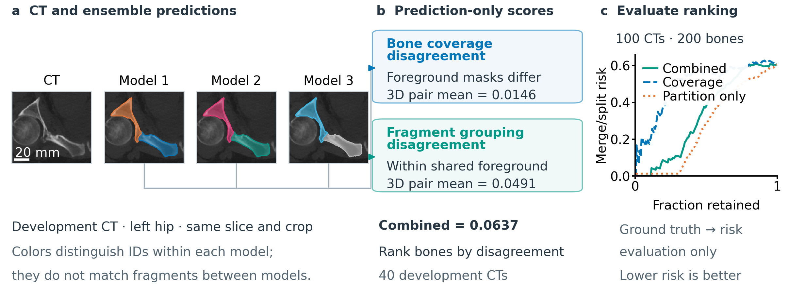

# Presence or Partition? Endpoint-Dependent Failure Detection in 3D Fracture Segmentation

Anonymous scientific draft for author review.

## Abstract

Disagreement among instance segmenters can reflect missing foreground or different groupings of the same foreground. These mechanisms need not identify the same errors. We study their separation in three-model segmentation of peripelvic fractures on CT. Controlled perturbations and component analysis use 40 development scans; a separate 100-scan evaluation compares 12 fixed scores. Dividing partition disagreement by joint entropy, rather than by the logarithm of voxel count, increases its contribution to the combined score. For pooled merge/split detection, this combined score achieves area under the risk--coverage curve 0.3311, compared with 0.4942 for foreground disagreement and 0.6358 for mean entropy; lower values indicate fewer errors among retained predictions. A partition-only score nevertheless performs better (0.2720). Its advantage is no longer clear under supplementary one-to-one and significant-overlap failure definitions. Unanimously missing bones can receive zero disagreement, revealing a limit of agreement-based quality control. These findings show why component controls and explicit failure definitions are necessary when evaluating prediction disagreement for quality control.


**Keywords:** 
instance segmentation, uncertainty, fracture CT, quality control, failure detection


## Introduction

Fragment-level CT segmentation can support geometric analysis of peripelvic fractures, but a plausible foreground mask can conceal incorrect fragment grouping. A merged or split fragment changes the instance representation even when foreground overlap is high. Before using such segmentations downstream, a quality-control system should identify the failures relevant to that representation. The public PENGWIN dataset provides annotated peripelvic fracture instances for studying this problem [pengwin2026].

Deep ensembles offer prediction-based uncertainty estimates [lakshminarayanan2017]. For instance maps, however, foreground disagreement and disagreement about object membership are different quantities. Combining an information-based partition term with a foreground term can suppress one component or prioritize a different error mechanism. Changing normalization increases the numerical contribution of a component, but does not by itself establish better failure ranking. A ranking statistic alone also does not establish savings in clinical review.

Previous segmentation studies show that the way pixel confidence is aggregated can determine failure-detection performance; pairwise foreground Dice is a particularly strong semantic-segmentation baseline [zenk2025]. Instance segmentation adds a different question: two predictions may cover the same bone yet divide it into different fragments. Annotation-inspection tools address related quality problems when a reference annotation is available [schilling2023], while reference-based quality estimation can add information beyond ensemble agreement [valindria2017]. We instead examine prediction-only fragment disagreement, using problem-aware evaluation principles [reinke2024, maier2024].

Our contributions are:


1. **A component-wise diagnosis of instance disagreement.** On 40 development CTs, we quantify the separate contributions of bone coverage and fragment grouping. Controlled fragment interventions verify their distinct responses; count replication isolates the normalization effect with fixed fragment proportions.

2. **A controlled benchmark of structural-failure ranking.** On 100 separate CTs (200 bones), we compare 12 scores with paired case-bootstrap intervals. The joint-entropy combined score improves over foreground disagreement and entropy, while a partition-only control remains stronger for the original merge/split endpoint.

3. **A matching-aware test of the conclusions.** Keeping predictions and scores fixed, we compare the original, one-to-one, and significant-overlap failure definitions. The apparent partition-only advantage changes with the endpoint, showing why a failure-detection claim must specify which errors count. A real shared-omission example further identifies an error that agreement alone cannot reveal.


## Methods

Figure 1 follows one CT through three model predictions, the two disagreement components, and failure ranking. Scores are computed from predictions alone; reference masks enter only the separate evaluation of errors.




**Figure 1.** Study overview using a real development CT and its three saved predictions. Colors distinguish fragments within a model, without assuming that fragment IDs correspond across models. Coverage and grouping contributions are computed for the whole 3D bone and averaged over model pairs; the displayed slice only illustrates the inputs. Reference masks are used for error evaluation, not to construct the scores. The final panel uses recorded predictions and risks from 100 separate evaluation CTs.


### Data, Models, and Evaluation Units

We used the public labeled PENGWIN 2026 Task 1 CT dataset [pengwin2026]. The evaluation involved 40 development scans and 100 additional scans, each balanced between pelvic and femur scan types. The latter were selected with a fixed seed from 210 eligible cases after excluding the initial training cases, development cases, and a separate local hold-back split. The local hold-back was not evaluated. Separation was checked by case ID; patient-level independence across the source collection was not independently established.

Three ensemble members used the same public two-stage STU-Net segmentation backend and initial 40-case training selection, with three different random seeds. The implementation used nnU-Net 2.5.1 infrastructure [isensee2021] and a fixed, patched version of the public implementation [abbc]. An anatomy model localized the bone crops, followed by fragment segmentation and affinity-based reconstruction using predicted connectivity. A fourth segmentation model supplied an alternative error target: scores stayed fixed while risks were recomputed from this model. It belongs to the same backend family and does not establish transfer across architectures. All checkpoint choices were fixed, and no model was trained on the additional 100 evaluation cases.

Scoring followed the declared annotation scope: three bones per pelvic scan (sacrum, left hip, right hip), and one femur unit per femur scan. This produced 80 development and 200 held-out bone units. Pooled bone-level statistics consequently weight a pelvic CT three times as much as a femur CT. Within the annotation scope, predicted components smaller than 1,000 mm$^3$ were removed using 26-connectivity; reference instances were retained. Bone identity came from scan metadata and predicted anatomy IDs, not a ground-truth region of interest (ROI).

For the ensemble, foreground probabilities were linearly mapped to the native grid and combined across anatomy crops by a voxelwise maximum. Entropy used these foreground maps, rather than separate probability channels for each bone. Its region of interest for each bone was the union of the cleaned member foregrounds. This keeps scoring independent of reference annotations, but an empty predicted union also removes the region over which entropy could reveal an error. Reference annotations entered only subsequent evaluation or controlled perturbation generation. Evaluation inference comprised 300 ensemble-member runs and 100 runs of the fourth model.


### Separating Presence and Partition

For one model pair, let $F_i,F_j$ denote foreground sets, $U=F_i\cup F_j$ their union, and $C=F_i\cap F_j$ their intersection. Presence disagreement measures how often only one model predicts foreground. The overlap weight measures how much foreground both models share:

$$

 A=\frac{|F_i\triangle F_j|}{|U|},\qquad w=\frac{|C|}{|U|}.

$$

The instance labels restricted to $C$ define partitions $P,Q$: each partition says which shared voxels belong to the same fragment. Using natural logarithms, variation of information is $\mathrm{VI}=H(P\mid Q)+H(Q\mid P)$, where conditional entropy measures the fragment information one prediction fails to determine about the other. Let $H=H(P,Q)$ denote joint entropy. Following established information-theoretic comparisons [vinh2010], we examine

$$

 Q_{\rm vox}=\frac{\mathrm{VI}}{\log |C|},\qquad
 Q_{\rm joint}=\frac{\mathrm{VI}}{H},

$$


$$

 D_{\rm vox}=A+wQ_{\rm vox},\qquad
 D_{\rm joint}=A+wQ_{\rm joint}.

$$

The subscripts identify normalization by voxel count or joint entropy. Each combined score adds presence disagreement to a weighted partition term; $wQ_{\rm vox}$ and $wQ_{\rm joint}$ are its partition-only controls. Increasing voxel count can enlarge $\log|C|$ even when the fragment proportions stay the same. Joint-entropy normalization instead depends on those proportions, making the denominator choice directly testable. These are analysis variants of established quantities, not proposed new mathematical distances. Partition terms are zero for $|C|\leq1$ or zero joint entropy. Two empty foregrounds yield zero disagreement; exactly one empty foreground yields total disagreement one. Scores are averaged over the three model pairs before aggregation across bone units.

All 12 scores were computed on the same inputs (Table I). The controls include mean and 95th-percentile entropy of the ensemble mean probability, foreground Dice and Jaccard disagreements, union-normalized VI (including background within $U$), instance-count variance, and disagreement after anatomy-constrained Hungarian matching by intersection over union (IoU). We also compare both combined scores, both weighted partition components, and unweighted $Q_{\rm joint}$. These controls distinguish an effect of normalization from the simpler possibility that foreground, fragment count, or fragment matching already detects the failures. Arbitrary fragment labels are never compared numerically.


### Mechanism Tests and Failure Endpoints

Controlled tests used 20 development CTs (10 per scan type; 40 bones), with unchanged labels, permuted labels, merges, splits, fragment removals, and boundary changes generated independently from reference copies. We merged one to three disjoint nearest-fragment pairs, split the largest fragment into two to four parts, and targeted foreground Dice of 0.99, 0.95, and 0.90 for boundary changes (tolerance 0.005). Merging alters grouping with unchanged foreground, whereas removing foreground changes presence. Eligibility was retained explicitly. Count replication multiplied every entry in a partition contingency table by $r\in\{1,2,4,8,16\}$ without changing its probabilities. VI, joint entropy, presence, and overlap weight should therefore remain fixed, while $Q_{\rm vox}$ decreases with $\log(r|C|)$. This isolates the denominator's algebra; it does not test model robustness to CT resampling. Merge severity was compared within fixed eligible bone cohorts so that changes in the sample could not masquerade as a severity response.

The original structural risk for a model and bone was $(M+S)/\max(N_{GT},1)$, where $M,S$ are internal merge and split counts. The evaluator assigns each reference to its best-IoU prediction when IoU$\geq0.1$; multiple references can share a prediction. Each additional predicted ID with any positive reference overlap contributes a split. Instance $F_1$, missing-instance rate, foreground Dice, and missing reference volume were recorded separately. Risks were evaluated for each model first, then averaged across the three members. These are internal endpoints, not the official PENGWIN evaluator.

Supplementary analyses on the already inspected cases used maximum-cardinality one-to-one IoU matching and significant overlap edges. An edge requires intersection volume divided by the larger object volume to be at least a fixed $\tau\in\{0.01,0.1\}$. Both thresholds were reported. This filters very small contacts but can also suppress legitimate highly unequal fragments; neither threshold is a validated clinical severity cutoff. The original scores and endpoints were preserved.


### Statistical Analysis

Higher scores prioritize review; lower scores are retained first. A risk--coverage curve reports the average error in the retained predictions as coverage increases. Area under this curve (AURC) integrates retained risk over coverage $1/n,\ldots,1$ using trapezoids and expected order within exact score ties. Lower AURC means that the ranking keeps fewer errors across the coverage range; it does not measure segmentation improvement after human correction. All comparisons use paired draws from 10,000 case-cluster bootstrap resamples, stratified by scan type and retaining every bone of each sampled case. Intervals are marginal 95% intervals, without familywise adjustment. The criterion encoded in the evaluation configuration required $D_{\rm joint}$ minus presence and $D_{\rm joint}$ minus mean-entropy structural AURC each to be at most $-0.02$, with both intervals below zero. This is the recorded comparison rule, not a claim of formal preregistration.


| Score | Dev. M+S | Eval. M+S | Eval. $1-F_1$ |
| --- | --- | --- | --- |
| Mean entropy | 0.6570 | 0.6358 | 0.1757 |
| 95th-percentile entropy | 0.6767 | 0.6381 | 0.1784 |
| Foreground Dice disagreement | 0.5442 | 0.4943 | 0.1611 |
| Presence (Jaccard disagreement) | 0.5442 | 0.4942 | 0.1611 |
| Union-normalized VI | 0.4342 | 0.3881 | 0.1534 |
| Instance-count variance | 0.5181 | 0.4704 | 0.1523 |
| Hungarian matching disagreement | 0.3933 | 0.3883 | 0.1331 |
| $D_{\rm vox}$ (combined) | 0.4906 | 0.4472 | 0.1557 |
| $wQ_{\rm vox}$ (partition only) | 0.2706 | 0.2720 | 0.1446 |
| $wQ_{\rm joint}$ (partition only) | 0.2891 | 0.2978 | 0.1424 |
| $D_{\rm joint}$ (combined) | 0.3318 | 0.3311 | 0.1453 |
| $Q_{\rm joint}$ (unweighted VI/H) | 0.2890 | 0.2987 | 0.1414 |


## Results


### Component Contributions and Controlled Responses

On the 80 development bones, changing from voxel-count to joint-entropy normalization increased the median weighted partition term from 0.001164 to 0.032116. Its median share of the corresponding combined score rose from 6.96% to 58.87%. Thus a component that contributed little numerically could become a major part of the score without changing the underlying predictions. Raw VI averaged over model pairs was at most $10^{-12}$ in 27/80 bones, however. Normalization therefore changes component scale but cannot create disagreement where the models already give the same grouping.

All 32 synthetic-phantom assertions passed. The CT-based perturbation study produced 452 eligible responses from 527 tests; 75 merge tests were ineligible because there were insufficient fragments. Unchanged and permuted labels produced zero disagreement. Merge/split interventions changed partition terms without changing presence, while the tested fragment-removal and boundary interventions changed presence with zero shared-partition VI. These responses confirm that the components distinguish the intended mechanisms under these controlled interventions. All 120 boundary targets met the declared tolerance. Count replication reconstructed 240 development contingencies and confirmed that voxel-count normalization shrinks the partition score despite unchanged fragment proportions.

Joint-entropy-normalized VI also saturated: 11 single-fragment bones had $Q_{\rm joint}=1$ at all three split levels. Once saturated, the score cannot distinguish a mild split from a more extensive split. For merges, the 12 bones eligible at both levels one and two had median $Q_{\rm joint}$ 0.01503 and 0.03302. The four eligible through level three had medians 0.00572, 0.01786, and 0.03235. These within-cohort increases show a response to the tested merges, but the saturation result prevents interpreting normalized VI as a universal count of structural severity.


### Held-Out Ranking and Stronger Component Controls

The joint-entropy combined score met the recorded pooled comparison criterion. Its structural AURC was lower by 0.16313 than presence (95% CI $[-0.21184,-0.11682]$) and by 0.30470 than mean entropy ($[-0.37159,-0.23683]$). These differences mean that, over the evaluated coverage range, the combined ranking retained fewer merge/split errors than either foreground-based control. Evaluating errors from the fourth model supported the same comparisons, with differences $-0.12760$ and $-0.28142$, respectively. Femur-only intervals crossed zero, so the pooled result does not establish a benefit separately for both scan types.

The partition-only control was stronger than the combined score on the original structural endpoint (Table I). Voxel-normalized partition disagreement achieved AURC 0.2720, compared with 0.3311 for the joint-entropy combined score, and the paired interval favored the partition-only control. A larger partition contribution therefore does not guarantee a better ranking: adding presence can change which errors receive highest priority. Hungarian matching disagreement had the lowest point AURC for the original $1-F_1$ endpoint, showing that the strongest score also depends on whether failure means incorrect grouping or poor instance detection.


| Failure definition | $\Delta$AURC | 95% CI |
| --- | --- | --- |
| Original M+S | +0.0591 | [+0.0393, +0.0801] |
| One-to-one $1-F_1$ | -0.0016 | [-0.0268, +0.0280] |
| Significant overlap, $\tau=.01$ | +0.0033 | [-0.0079, +0.0143] |
| Significant overlap, $\tau=.10$ | -0.0009 | [-0.0055, +0.0035] |
| Missing volume | +0.0078 | [-0.0138, +0.0357] |


### Dependence on the Failure Definition

The supplementary evaluation reproduced the original per-model risks before recomputing alternative endpoints on the same 40 development and 100 evaluation CTs. For the separate evaluation cohort, the joint-entropy combined score was worse than voxel-normalized partition disagreement under the original merge/split definition, but this disadvantage was no longer clear for one-to-one $1-F_1$ or either significant-overlap definition (Table II). The segmentations and scores stayed fixed; only the definition of failure changed. The result therefore shows endpoint dependence, not improved segmentation or superiority of the combined score under the alternative definitions. The different risk scales also prevent comparing absolute AURCs across endpoint definitions.


### Shared Omission as an Information Limit

In one evaluation example, the left hip contained five reference fragments, but all three ensemble models and the fourth model predicted an empty bone. Every ensemble disagreement score was zero, while missing-volume risk was one and merge/split risk was zero. Agreement had assigned the lowest uncertainty to a completely missed bone, and a merge/split endpoint alone did not count that omission. This failure requires information beyond disagreement among identical predictions.


## Discussion

The experiments separate score magnitude from failure-detection value. Replication shows that a voxel-count denominator can suppress partition disagreement without any change in fragment proportions. The separate evaluation cohort shows that removing this suppression helps the combined score against foreground controls, while leaving a partition-only control stronger on the original structural endpoint. Supplementary matching rules then change that comparison without changing any prediction. In this setting, choosing a quality-control score requires a stated failure definition; a larger numerical component alone does not justify that choice. This agrees with problem-aware validation recommendations [reinke2024, maier2024]: scale, evaluation unit, and failure definition need separate controls.

Disagreement cannot distinguish unanimous correctness from unanimous error when its inputs are identical. Even entropy vanishes here for an empty predicted region. Detecting such failures requires image, anatomical, or independent reference evidence, as illustrated by reference-based approaches [valindria2017]. An expected-bone rule also cannot be transferred unchanged to data containing genuine negative subjects.

The main limitations are one segmentation-backend family, only three ensemble members, limited femur precision, and no independent replication of the supplementary endpoint analyses. Pooled bone weighting differs from equal-CT review cost, so pooled ranking gains cannot be translated directly into a percentage of scans saved from review. Prediction cleanup can remove small components while reference annotations retain small fragments. Significant-overlap thresholds were diagnostic choices rather than clinically validated cutoffs. Clinical correction, decision consequences, reading time, and external-dataset transfer were not evaluated. The findings consequently characterize the behavior of disagreement scores in this setting; they do not establish clinical savings or safety across datasets.


## Conclusion

Joint-entropy normalization improved combined-score ranking over presence and entropy, but voxel-normalized partition disagreement remained stronger under the original structural endpoint. That advantage depended on the failure definition, while shared omissions stayed invisible to disagreement. Component controls, matching sensitivity, and explicit omission checks are therefore needed together when assessing disagreement-based quality control in this setting.


## Acknowledgment

OpenAI Codex (GPT-6 family) assisted with code, analysis scripts, figures, and manuscript preparation. The authors remain responsible for verification and interpretation. This draft uses public anonymized data and reports no new patient recruitment or clinical intervention.


## References

```bibtex
@misc{pengwin2026,
 author={Yanzhen Liu and Sutuke Yibulayimu and Zdravko Marinov and others},
 title={{PENGWIN} 2026 Task 1 and Task 2: Peripelvic Fracture Segmentation Dataset},
 publisher={Zenodo},year={2026},doi={10.5281/zenodo.19732767},url={https://zenodo.org/records/19732767}}
@inproceedings{lakshminarayanan2017,
 author={Balaji Lakshminarayanan and Alexander Pritzel and Charles Blundell},
 title={Simple and Scalable Predictive Uncertainty Estimation using Deep Ensembles},
 booktitle={Advances in Neural Information Processing Systems},volume={30},year={2017},
 url={https://papers.nips.cc/paper_files/paper/2017/hash/9ef2ed4b7fd2c810847ffa5fa85bce38-Abstract.html}}
@article{vinh2010,
 author={Nguyen Xuan Vinh and Julien Epps and James Bailey},
 title={Information Theoretic Measures for Clusterings Comparison: Variants, Properties, Normalization and Correction for Chance},
 journal={Journal of Machine Learning Research},volume={11},pages={2837--2854},year={2010},url={https://www.jmlr.org/papers/v11/vinh10a.html}}
@article{isensee2021,
 author={Fabian Isensee and Paul F. Jaeger and Simon A. A. Kohl and Jens Petersen and Klaus H. Maier-Hein},
 title={{nnU-Net}: a self-configuring method for deep learning-based biomedical image segmentation},
 journal={Nature Methods},volume={18},pages={203--211},year={2021},doi={10.1038/s41592-020-01008-z}}
@misc{abbc,
 title={{PENGWIN} 2026 Task 1 {ABBC}: public reference implementation},
 howpublished={GitHub repository},url={https://github.com/RURUGURU/pengwin2026-task1-abbc},
 note={Reference commit ccc625fd000ec2dfce622b4621bf2d0b4ee12796; project patch and environment recorded with artifacts},year={2026}}
@article{reinke2024,
 author={Annika Reinke and Minu D. Tizabi and Michael Baumgartner and others},
 title={Understanding metric-related pitfalls in image analysis validation},journal={Nature Methods},
 volume={21},pages={182--194},year={2024},doi={10.1038/s41592-023-02150-0}}
@article{maier2024,
 author={Lena Maier-Hein and Annika Reinke and Patrick Godau and others},
 title={Metrics reloaded: recommendations for image analysis validation},journal={Nature Methods},
 volume={21},pages={195--212},year={2024},doi={10.1038/s41592-023-02151-z}}
@article{valindria2017,
 author={Vanya V. Valindria and Ioannis Lavdas and Wenjia Bai and others},
 title={Reverse Classification Accuracy: Predicting Segmentation Performance in the Absence of Ground Truth},
 journal={IEEE Transactions on Medical Imaging},volume={36},number={8},pages={1597--1606},year={2017},doi={10.1109/TMI.2017.2665165}}
@inproceedings{schilling2023,
 author={Marcel P. Schilling and Lukas Klinger and Ulrike Schumacher and Svenja Schmelzer and Miguel {Bordallo L\'opez} and Britta Nestler and Markus Reischl},
 title={{AI2Seg}: A Method and Tool for {AI}-based Annotation Inspection of Biomedical Instance Segmentation Datasets},
 booktitle={Annual International Conference of the IEEE Engineering in Medicine and Biology Society (EMBC)},pages={1--6},year={2023},doi={10.1109/EMBC40787.2023.10341074}}

@article{zenk2025,
 author={Maximilian Zenk and David Zimmerer and Fabian Isensee and Jeremias Traub and Tobias Norajitra and Paul F. J{\"a}ger and Klaus Maier-Hein},
 title={Comparative benchmarking of failure detection methods in medical image segmentation: Unveiling the role of confidence aggregation},
 journal={Medical Image Analysis},volume={101},pages={103392},year={2025},doi={10.1016/j.media.2024.103392}}
```
