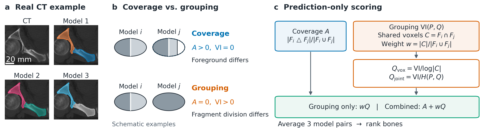
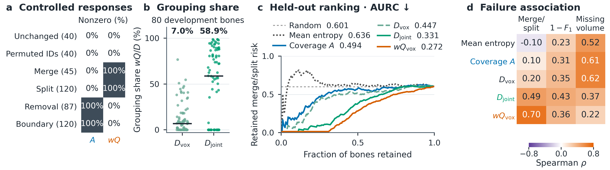

# Presence or Partition? Decomposing Ensemble Disagreement to Detect Structural Failures in 3D Fracture Segmentation

Anonymous scientific draft for author review.

## Abstract

Fracture segmentation for reduction planning must delineate every bone fragment as a separate object, yet a merged or split fragment can leave the segmented bone surface intact. Automated quality control usually ranks cases by voxel uncertainty or foreground disagreement among ensemble members, signals that are blind to such grouping errors by construction. We decompose the disagreement between two instance segmentations into a coverage term (foreground disagreement) and a grouping term (variation of information on the shared foreground) and evaluate both in a three-model ensemble for peripelvic fracture CT. In 452 controlled interventions, the two terms responded to disjoint mechanisms: merges and splits changed only grouping, whereas fragment removal and boundary shifts changed only coverage. We further show that normalizing variation of information by the logarithm of the voxel count, a common choice, reduces grouping to a median 7% of the combined score; joint-entropy normalization restores it to 59%. On 200 bones from 100 held-out CTs, voxel entropy ranked merge/split failures no better than chance (area under the risk--coverage curve, AURC, 0.636 vs.\ 0.601), whereas the grouping term alone reached 0.272. Restoring grouping lowered the AURC of the combined score by 0.116 and met the primary criterion against foreground disagreement and entropy. Grouping disagreement is thus a distinct signal that instance-level quality control should measure explicitly.


**Keywords:** 
instance segmentation, uncertainty, quality control, failure detection, fracture CT


## Introduction

Computer-assisted reduction planning for pelvic and femoral fractures requires every bone fragment in CT as a separate object [sang2026, pengwin2026]. The critical segmentation failures are therefore *structural*: fragments merged or split. Such errors can leave the bone surface, and thus every voxel-overlap metric, almost unchanged. Deployment needs automated quality control (QC) that flags them for review without a reference.

Ensemble disagreement is a widely used prediction-only QC signal [lakshminarayanan2017, mehrtash2020], and failure-detection benchmarks show that how it is aggregated and evaluated determines its value [zenk2025, jaeger2023]. Existing scores, however, measure *where* the ensemble predicts bone: voxel entropy, pairwise Dice, or structure-wise overlap [roy2019]. When members agree on the bone surface but group it into fragments differently, these scores report agreement. Comparing instance maps directly captures grouping, but must cope with arbitrary fragment labels and with coverage and grouping mixed into one number.

Our central observation is that pairwise instance disagreement separates exactly into these two mechanisms, and that their balance in a combined score is governed by a seemingly technical choice: how grouping disagreement is normalized. We make three contributions:


1. **A correspondence-free decomposition** of instance disagreement into coverage and grouping terms, with controlled interventions showing a complete double dissociation and an analysis showing that voxel-count normalization suppresses the grouping signal, whereas joint-entropy normalization does not.

2. **A held-out benchmark of 12 prediction-only scores** on 200 bones from 100 CTs, showing that voxel and foreground uncertainty miss structural failures, that grouping disagreement detects them, and that correcting the normalization alone lowers the AURC of the combined score by 0.116.

3. **An analysis of evaluation conditions**, showing how the comparison depends on the failure definition and why unanimous omissions require evidence beyond agreement.




**Figure 1.** Coverage and grouping disagreement. (a) Real output of the three ensemble members for one development CT (left hip, axial slice); colors distinguish fragments within each model and carry no correspondence across models. Scores are computed on the whole 3D bone. (b) Schematic: two models can disagree about which voxels are bone (coverage) or about how the same voxels are divided into fragments (grouping). (c) Score construction for one bone. Coverage $A$ and grouping $\mathrm{VI}$ are computed per model pair without matching fragment labels, averaged over the three pairs, and used to rank bones for review. References only define the failures to be prioritized.


## Related Work

\textit{Uncertainty for segmentation QC.} Ensembles and Monte Carlo sampling yield voxelwise uncertainty [lakshminarayanan2017, mehrtash2020], aggregated per structure for QC [roy2019]. Benchmarks evaluate such scores by risk--coverage analysis [geifman2017, jaeger2023] and identify pairwise Dice between members as a strong baseline [zenk2025]. All quantify foreground agreement. Reference-based quality estimation [valindria2017] and annotation inspection [schilling2023] require reference data.

\textit{Instance-level uncertainty and evaluation.} Instance comparison usually relies on object matching, e.g., one-to-one IoU matching in panoptic quality [kirillov2019], and instance uncertainty is derived from matched samples [siddiqui2024]. Matching becomes ambiguous exactly when objects merge or split.

\textit{Comparing partitions.} Variation of information (VI) compares two partitions without label correspondence [meila2007]; its normalized variants differ in scale and invariance [vinh2010]. We apply VI to the foreground shared by two predictions, separating grouping from coverage, and test which normalization serves failure detection. We also test the dependence on the failure definition stressed by validation guidelines [reinke2024, maier2024].


## Methods


### Decomposing Pairwise Instance Disagreement

For one bone and a pair of models $(i,j)$, let $F_i,F_j$ be the predicted foreground voxels, $U=F_i\cup F_j$ and $C=F_i\cap F_j$ (Fig. 1). Coverage disagreement and the shared fraction are

$$

A=\frac{|F_i\,\triangle\,F_j|}{|U|},\qquad w=\frac{|C|}{|U|}=1-A .

$$

The fragment labels of each model restricted to $C$ define partitions $P$ and $Q$ of the shared voxels. Grouping disagreement is $\mathrm{VI}(P,Q)=H(P\mid Q)+H(Q\mid P)$ (natural logarithms) [meila2007]. VI depends only on which voxels are grouped together, so arbitrary label values never need to be matched. By construction, $A=0$ when two predictions cover the same voxels, and $\mathrm{VI}=0$ when they group the shared voxels identically: the two terms isolate different mechanisms.

\textit{Normalization.} A common choice divides VI by its trivial upper bound $\log|C|$. For a bone with few fragments, however, VI is bounded by $2\log K$ for $K$ fragments [meila2007], whereas $\log|C|\approx 13$ for the roughly $4\times10^5$ voxels that two predictions of a bone typically share. Grouping disagreement is thus compressed by an order of magnitude relative to $A\in[0,1]$, and the compression grows with image resolution. Dividing by the joint entropy $H(P,Q)$ instead yields a bounded quantity that depends only on fragment proportions [vinh2010]:

$$

Q_{\rm vox}=\frac{\mathrm{VI}}{\log|C|},\qquad Q_{\rm joint}=\frac{\mathrm{VI}}{H(P,Q)}\in[0,1].

$$

Weighting by the shared fraction gives the grouping-only scores $wQ_{\rm vox}$ and $wQ_{\rm joint}$; adding coverage gives the combined scores

$$

D_{\rm vox}=A+wQ_{\rm vox},\qquad D_{\rm joint}=A+wQ_{\rm joint}.

$$

Grouping terms are zero if $|C|\leq1$ or $H(P,Q)=0$; two empty predictions give $A=0$, one empty prediction gives $A=1$. Each score is averaged over the three model pairs.


### Compared Scores

All 12 scores use the same predictions (Table I): mean and 95th-percentile entropy of the ensemble-mean foreground probability within the union of member foregrounds; pairwise Dice and Jaccard ($A$) disagreement; predicted instance-count variance; VI over the union including background; disagreement after anatomy-constrained Hungarian IoU matching; and the five decomposition scores. The controls test whether foreground, fragment count, or explicit matching already detects the failures.


### Data and Models

We used the public labeled PENGWIN 2026 Task 1 CT dataset [pengwin2026]. A development cohort of 40 CTs and a held-out cohort of 100 CTs, each balanced between pelvic and femoral scans, were disjoint from the training cases; the held-out cases were drawn with a fixed seed from 210 eligible cases. Pelvic scans contribute three bones (sacrum, left and right hip) and femoral scans one, giving 80 development and 200 held-out bone units; pooled statistics weight each bone equally.

The ensemble comprised three members of the public two-stage STU-Net pipeline [abbc] (nnU-Net [isensee2021]; anatomy localization, then affinity-based fragment reconstruction), trained on the same 40 cases with different seeds. Predicted components below 1{,}000 mm$^3$ were removed (26-connectivity). Bone identity came from scan metadata and predicted anatomy labels; references never entered scoring. A fourth, separately trained model of the same family served only as an alternative error source.


### Failure Endpoints and Statistical Analysis

The primary structural risk of a model on a bone is $(M+S)/\max(N_{\rm ref},1)$, where $N_{\rm ref}$ is the number of reference fragments, a merge ($M$) is a reference fragment whose best-IoU prediction (IoU\,$\geq0.1$) is shared with another reference, and a split ($S$) is each additional predicted fragment overlapping a reference. Instance $1-F_1$ and missing reference volume were recorded as secondary endpoints. Risks were computed per member and averaged over members.

Bones with the lowest scores are retained first; at coverage $c$, the risk--coverage curve gives the mean risk of the retained fraction [geifman2017, jaeger2023]. AURC integrates this curve over coverage $1/n,\ldots,1$ (trapezoids, expected order within exact ties); lower is better, and a random ranking defines the chance level. Paired AURC differences use 10{,}000 case-cluster bootstrap resamples stratified by scan type, resampling CTs with all their bones; we report marginal 95% intervals. Normalization was selected on the development cohort. Because a QC score must respond to coverage and grouping failures alike, the combined score was the primary object and the component scores served as controls. The primary held-out criterion, recorded in the evaluation configuration, required $D_{\rm joint}$ to improve AURC over both coverage $A$ and mean entropy by at least 0.02, with both intervals below zero; all other contrasts are secondary.


### Controlled Mechanism Tests

On 20 development CTs (10 per scan type; 40 bones), reference instance maps were perturbed and compared with their unperturbed copies: unchanged and permuted labels; merges of one to three nearest fragment pairs; splits of the largest fragment into two to four parts; removal of fragments; and boundary shifts to Dice 0.99, 0.95, and 0.90 (tolerance 0.005). Merges lacking enough fragments were recorded as ineligible. To isolate the denominator, every count of 240 development contingency tables was multiplied by $r\in\{1,2,4,8,16\}$, which preserves all fragment proportions.




**Figure 2.** Evidence for the decomposition. (a) Controlled interventions on reference instance maps (number of eligible interventions in parentheses): fraction producing a nonzero coverage ($A$) or grouping ($wQ$) response. (b) Share of the grouping term in the combined score on 80 development bones (median marked); 27 bones on which all models group identically have share zero under both normalizations. (c) Held-out risk--coverage curves for merge/split risk; bones with the lowest score are retained first, so a lower curve retains fewer failures. (d) Spearman correlation between the five displayed scores and each held-out risk; coverage and grouping terms align with different failure types.


## Results


### Coverage and Grouping Capture Disjoint Failure Mechanisms

All 452 eligible interventions separated cleanly (Fig. 2a). Every merge (45) and split (120) produced a positive grouping response with zero coverage response, and every fragment removal (87) and boundary shift (120) produced the reverse. Unchanged and relabeled maps produced zero for both terms, confirming invariance to fragment labels. Within the 4 bones eligible at all three merge levels, the median $Q_{\rm joint}$ increased monotonically (0.006, 0.018, 0.032). For bones with a single reference fragment, however, any split already yields $Q_{\rm joint}=1$ (11 bones), so the term flags structural change without grading its extent.


### Voxel-Count Normalization Suppresses Grouping

Under $D_{\rm vox}$, grouping contributed a median of only 7.0% of the combined score on development bones; under $D_{\rm joint}$, 58.9% (Fig. 2b). The suppression is visible in the controlled merges, where the median grouping term was 0.0018 with voxel-count and 0.047 with joint-entropy normalization. Count replication confirmed the origin: with fragment proportions fixed, VI, $H(P,Q)$, $A$, $w$, and $Q_{\rm joint}$ were exactly unchanged across all 240 tables, whereas $Q_{\rm vox}$ fell by a median of 18% at $r=16$. On 27 of 80 bones, all models grouped the shared foreground identically, so neither normalization produced a signal.


|  | Dev. | \multicolumn{2}{c}{Held-out} |
| --- | --- | --- |
| Score | M+S | M+S | $1-F_1$ |
| Random ranking | 0.647 | 0.601 | 0.196 |
| \quad Mean entropy | 0.657 | 0.636 | 0.176 |
| \quad 95th-percentile entropy | 0.677 | 0.638 | 0.178 |
| \quad Pairwise Dice disagreement | 0.544 | 0.494 | 0.161 |
| \quad Coverage $A$ (Jaccard) | 0.544 | 0.494 | 0.161 |
| \quad Instance-count variance | 0.518 | 0.470 | 0.152 |
| \quad Union-normalized VI | 0.434 | 0.388 | 0.153 |
| \quad Hungarian matching | 0.393 | 0.388 | **0.133** |
| \quad Combined $D_{\rm vox}$ | 0.491 | 0.447 | 0.156 |
| \quad Combined $D_{\rm joint}$ | 0.332 | 0.331 | 0.145 |
| \quad Grouping $Q_{\rm joint}$ | 0.289 | 0.299 | 0.141 |
| \quad Grouping $wQ_{\rm joint}$ | 0.289 | 0.298 | 0.142 |
| \quad Grouping $wQ_{\rm vox}$ | **0.271** | **0.272** | 0.145 |


### Grouping Disagreement Detects Held-Out Structural Failures

On the held-out cohort, 138 of 200 bones had a nonzero merge/split risk. Voxel entropy ranked these failures no better than chance (AURC 0.636 vs.\ 0.601 for a random ranking; Table I): high-entropy bones were not the ones with structural errors (Spearman $\rho=-0.10$; Fig. 2d). Coverage disagreement improved only moderately (0.494). The grouping-only scores were the strongest (0.272 for $wQ_{\rm vox}$, 0.298 for $wQ_{\rm joint}$), and the risk--coverage curves show the practical difference: at 30% coverage, the bones retained by $wQ_{\rm vox}$ had a mean merge/split risk of 0.013, compared with 0.509 for coverage and 0.615 for entropy (Fig. 2c).

$D_{\rm joint}$ met the primary criterion. Its AURC was lower than that of coverage by 0.163 (95% CI $[-0.212,-0.117]$) and lower than that of mean entropy by 0.305 ($[-0.372,-0.237]$). Correcting the normalization alone, from $D_{\rm vox}$ to $D_{\rm joint}$, reduced AURC by 0.116 ($[-0.157,-0.077]$), and $D_{\rm joint}$ also outperformed matching-based (Hungarian, $-0.057$, $[-0.087,-0.030]$) and count-based ($-0.139$, $[-0.182,-0.096]$) disagreement. The primary contrasts were reproduced when risks came from the fourth model ($-0.128$ and $-0.281$; both intervals below zero).

Grouping alone nevertheless ranked structural failures better than the combined score ($D_{\rm joint}-wQ_{\rm vox}=+0.059$, $[0.039,0.080]$). The correlations suggest why: coverage was nearly unrelated to merge/split risk ($\rho=0.10$) but tracked missing volume ($\rho=0.61$), whereas grouping showed the opposite pattern ($\rho=0.70$ and $0.22$). The held-out data thus reproduce the dissociation of Fig. 2a, and adding coverage dilutes a structural ranking with an orthogonal signal. The gains were concentrated in pelvic bones ($D_{\rm joint}$ vs.\ coverage, $-0.146$, $[-0.194,-0.102]$). In femoral scans, 48 of 50 bones contained a structural error, leaving little room for any ranking (random AURC 0.955); femur-only intervals included zero.


| Failure definition | $\Delta$AURC | 95% CI |
| --- | --- | --- |
| Merge/split (primary) | +0.0591 | [+0.0393, +0.0801] |
| One-to-one matched $1-F_1$ | -0.0016 | [-0.0268, +0.0280] |
| Merge/split, overlap $\geq 1%$ | +0.0033 | [-0.0079, +0.0143] |
| Merge/split, overlap $\geq 10%$ | -0.0009 | [-0.0055, +0.0035] |
| Missing volume | +0.0078 | [-0.0138, +0.0357] |


### Dependence on the Failure Definition

With predictions and scores fixed, we recomputed risk under alternative definitions (Table II): one-to-one maximum-cardinality matching; merge/split counting only overlaps whose intersection covers at least a fraction $\tau\in\{0.01,0.1\}$ of the larger object; and missing volume. The advantage of grouping alone over $D_{\rm joint}$ held for the primary endpoint but vanished under each alternative, with all intervals spanning zero. The primary endpoint counts every extra predicted fragment that touches a reference fragment as a split, however small the contact; requiring one-to-one matches or a minimum overlap removes the gap between the two scores. For instance detection ($1-F_1$), Hungarian matching gave the lowest AURC (0.133; Table I). Which score is best is therefore a property of the failure definition, not of the scores alone.


### Unanimous Omission

One held-out left hip had five reference fragments, but all three members and the fourth model predicted no bone. Every one of the 12 scores was zero, the lowest possible priority, although missing volume was complete. Coverage disagreement otherwise identified large omissions well: of the six bones with the largest missing volume, four received the four highest coverage scores among all 200 bones. Disagreement detects omissions that the models make differently, not omissions they share.


## Discussion

Instance-level QC needs a grouping signal that foreground-based uncertainty does not provide. Structural failures can arise under confident, consistent voxel predictions; consistent with this, entropy and foreground disagreement ranked them near chance, while VI on the shared foreground ranked them well.

Normalization is not a cosmetic choice: dividing VI by $\log|C|$ ties grouping to voxel count and effectively turns a combined score into a coverage score (Fig. 2d), whereas joint entropy restores the balance. Because the terms track different failures, we recommend reporting them separately, or weighting them by the failure of interest, and stating the failure definition, which changed the ordering of the best scores.

When every model omits the same bone, there is no disagreement to measure; a practical system should add an expected-anatomy check or reference-based quality estimation [valindria2017].

Our evidence comes from one dataset and one segmentation family with three members; diverse architectures may shift the balance between the terms. Translating ranking gains into reading time or correction effort requires a reader study.


## Conclusion

Ensemble disagreement in fracture instance segmentation decomposes into coverage and grouping, which detect different failures. Grouping disagreement identified structural failures that voxel uncertainty missed, and joint-entropy normalization prevented its suppression in a combined score. Instance-level QC should measure grouping explicitly, normalize it independently of image size, and state the failure definition it targets.


## Acknowledgment

Generative AI tools were used: OpenAI Codex (GPT-6 family) for code, analysis scripts, and earlier drafting, and Anthropic Claude (Opus 5.5) for manuscript revision and figure preparation. The authors verified all content and take full responsibility for it. The study used public anonymized data; no patients were recruited.


## References

```bibtex
@misc{pengwin2026,
 author={Yanzhen Liu and Sutuke Yibulayimu and Zdravko Marinov and others},
 title={{PENGWIN} 2026 Task 1 and Task 2: Peripelvic Fracture Segmentation Dataset},
 publisher={Zenodo},year={2026},doi={10.5281/zenodo.19732767},url={https://zenodo.org/records/19732767}}
@inproceedings{lakshminarayanan2017,
 author={Balaji Lakshminarayanan and Alexander Pritzel and Charles Blundell},
 title={Simple and Scalable Predictive Uncertainty Estimation using Deep Ensembles},
 booktitle={Advances in Neural Information Processing Systems},volume={30},year={2017},
 url={https://papers.nips.cc/paper_files/paper/2017/hash/9ef2ed4b7fd2c810847ffa5fa85bce38-Abstract.html}}
@article{vinh2010,
 author={Nguyen Xuan Vinh and Julien Epps and James Bailey},
 title={Information Theoretic Measures for Clusterings Comparison: Variants, Properties, Normalization and Correction for Chance},
 journal={Journal of Machine Learning Research},volume={11},pages={2837--2854},year={2010},url={https://www.jmlr.org/papers/v11/vinh10a.html}}
@article{isensee2021,
 author={Fabian Isensee and Paul F. Jaeger and Simon A. A. Kohl and Jens Petersen and Klaus H. Maier-Hein},
 title={{nnU-Net}: a self-configuring method for deep learning-based biomedical image segmentation},
 journal={Nature Methods},volume={18},pages={203--211},year={2021},doi={10.1038/s41592-020-01008-z}}
@misc{abbc,
 title={{PENGWIN} 2026 Task 1 {ABBC}: public reference implementation},
 howpublished={GitHub repository},url={https://github.com/RURUGURU/pengwin2026-task1-abbc},
 note={Reference commit ccc625fd000ec2dfce622b4621bf2d0b4ee12796; project patch and environment recorded with artifacts},year={2026}}
@article{reinke2024,
 author={Annika Reinke and Minu D. Tizabi and Michael Baumgartner and others},
 title={Understanding metric-related pitfalls in image analysis validation},journal={Nature Methods},
 volume={21},pages={182--194},year={2024},doi={10.1038/s41592-023-02150-0}}
@article{maier2024,
 author={Lena Maier-Hein and Annika Reinke and Patrick Godau and others},
 title={Metrics reloaded: recommendations for image analysis validation},journal={Nature Methods},
 volume={21},pages={195--212},year={2024},doi={10.1038/s41592-023-02151-z}}
@article{valindria2017,
 author={Vanya V. Valindria and Ioannis Lavdas and Wenjia Bai and others},
 title={Reverse Classification Accuracy: Predicting Segmentation Performance in the Absence of Ground Truth},
 journal={IEEE Transactions on Medical Imaging},volume={36},number={8},pages={1597--1606},year={2017},doi={10.1109/TMI.2017.2665165}}
@inproceedings{schilling2023,
 author={Marcel P. Schilling and Lukas Klinger and Ulrike Schumacher and Svenja Schmelzer and Miguel {Bordallo L\'opez} and Britta Nestler and Markus Reischl},
 title={{AI2Seg}: A Method and Tool for {AI}-based Annotation Inspection of Biomedical Instance Segmentation Datasets},
 booktitle={Annual International Conference of the IEEE Engineering in Medicine and Biology Society (EMBC)},pages={1--6},year={2023},doi={10.1109/EMBC40787.2023.10341074}}

@article{zenk2025,
 author={Maximilian Zenk and David Zimmerer and Fabian Isensee and Jeremias Traub and Tobias Norajitra and Paul F. J{\"a}ger and Klaus Maier-Hein},
 title={Comparative benchmarking of failure detection methods in medical image segmentation: Unveiling the role of confidence aggregation},
 journal={Medical Image Analysis},volume={101},pages={103392},year={2025},doi={10.1016/j.media.2024.103392}}

@article{sang2026,
 author={Yudi Sang and Yanzhen Liu and Sutuke Yibulayimu and others},
 title={Benchmark of Segmentation Techniques for Pelvic Fracture in {CT} and {X}-Ray: Summary of the {PENGWIN} 2024 Challenge},
 journal={IEEE Transactions on Medical Imaging},volume={45},number={5},pages={2212--2228},year={2026},doi={10.1109/TMI.2025.3650126}}
@article{meila2007,
 author={Marina Meil\u{a}},
 title={Comparing clusterings---an information based distance},
 journal={Journal of Multivariate Analysis},volume={98},number={5},pages={873--895},year={2007},doi={10.1016/j.jmva.2006.11.013}}
@inproceedings{geifman2017,
 author={Yonatan Geifman and Ran El-Yaniv},
 title={Selective Classification for Deep Neural Networks},
 booktitle={Advances in Neural Information Processing Systems},volume={30},year={2017}}
@inproceedings{jaeger2023,
 author={Paul F. Jaeger and Carsten T. L{\"u}th and Lukas Klein and Till J. Bungert},
 title={A Call to Reflect on Evaluation Practices for Failure Detection in Image Classification},
 booktitle={International Conference on Learning Representations (ICLR)},year={2023}}
@article{roy2019,
 author={Abhijit Guha Roy and Sailesh Conjeti and Nassir Navab and Christian Wachinger},
 title={Bayesian {QuickNAT}: Model uncertainty in deep whole-brain segmentation for structure-wise quality control},
 journal={NeuroImage},volume={195},pages={11--22},year={2019},doi={10.1016/j.neuroimage.2019.03.042}}
@inproceedings{kirillov2019,
 author={Alexander Kirillov and Kaiming He and Ross Girshick and Carsten Rother and Piotr Doll{\'a}r},
 title={Panoptic Segmentation},
 booktitle={Proceedings of the IEEE/CVF Conference on Computer Vision and Pattern Recognition (CVPR)},pages={9404--9413},year={2019}}
@article{mehrtash2020,
 author={Alireza Mehrtash and William M. Wells and Clare M. Tempany and Purang Abolmaesumi and Tina Kapur},
 title={Confidence Calibration and Predictive Uncertainty Estimation for Deep Medical Image Segmentation},
 journal={IEEE Transactions on Medical Imaging},volume={39},number={12},pages={3868--3878},year={2020},doi={10.1109/TMI.2020.3006437}}
@inproceedings{siddiqui2024,
 author={Qasim M. K. Siddiqui and Sebastian Starke and Peter Steinbach},
 title={Uncertainty Estimation in Instance Segmentation with Star-Convex Shapes},
 booktitle={Proceedings of the IEEE/CVF Winter Conference on Applications of Computer Vision (WACV)},pages={1424--1433},year={2024}}
```
